# Liberia Shop / TechShop Liberia

[](https://lib-onlineshop.gt.tc)
[](https://www.php.net)
[](https://mariadb.org)
[](https://getbootstrap.com)

TechShop Liberia, developed as **Liberia Shop**, is a responsive e-commerce and store-management platform for customers, administrators, and selling staff in Liberia. It supports online shopping, in-person sales, inventory control, payment recording, order processing, invoices, staff performance, and mobile storefront access.

- **Live site:** https://lib-onlineshop.gt.tc
- **Repository:** https://github.com/Archie-ctr/Liberia-Shop
- **Developer / owner:** Archie K Gonwoe Jr
- **Contact:** archiekgonwoe@gmail.com
- **GitHub:** https://github.com/Archie-ctr

## Current System Interface

### Storefront

- Responsive homepage, product catalog, category browsing, search, and product details
- Multiple product images with storefront gallery thumbnails
- Shopping cart and wishlist
- Customer registration and login
- Checkout and payment-method selection
- Customer order history and order status
- Product reviews and ratings
- Liberia-focused footer, shop information, contact details, and social links
- Mobile navigation and bottom-tab storefront controls
- Extension-free web addresses such as `/store`, `/faq`, and `/product`
- Dynamic pricing through the system currency configuration

### Customer Information Pages

- About Us
- Contact Us
- Frequently Asked Questions
- Shipping Policy
- Returns and Refunds
- Privacy Policy

### Administration Dashboard

- Overview dashboard for orders, customers, products, revenue, and system activity
- Compact modal-based product creation and editing
- Category, brand, product, and inventory management
- Product gallery image uploads and removal
- Electronics and catalog management
- Customer and user management
- Pending, completed, and cancelled order views
- Invoice generation and PDF download
- Payment management and payment-status synchronization
- Store banners, promotions, coupons, and blog content
- Shop settings, payment settings, shipping settings, and tax settings
- Backup creation, settings, history, and restore tools
- Support tickets and system logs
- Responsive sidebar for mobile and tablet administration

### Staff / Seller Features

- Staff accounts with editor/seller roles and account activation controls
- Shared secure login experience for administrators, staff, and customers
- In-person point-of-sale (POS) workflow
- Walk-in customer name, phone number, product, quantity, and payment-method entry
- Cash, mobile-money, and card sale recording
- Automatic order creation, inventory reduction, and inventory logging
- Pending-order confirmation with staff attribution
- Staff reports for daily, monthly, and yearly periods
- Sales revenue, sales-order counts, confirmations, account status, and last-login reporting
- CSV export for staff performance data

## Roles

| Role | Access |
|---|---|
| Super administrator | Full system administration |
| Administrator | Dashboard, catalog, orders, payments, reports, staff management, and settings |
| Editor / staff seller | Selling, product inventory access according to permissions, POS sales, invoices, and permitted order operations |
| Customer | Catalog, cart, wishlist, checkout, reviews, and personal orders |

## Technology Stack

- **Backend:** PHP 8
- **Database:** MySQL / MariaDB
- **Frontend:** HTML5, CSS3, JavaScript, Bootstrap, jQuery
- **Server:** Apache with `.htaccess` clean URLs
- **Icons:** Material Icons and Font Awesome
- **Payments:** Cash, mobile money, and configured payment integrations/display options
- **Hosting:** InfinityFree-compatible production setup
- **Reporting:** Server-side PHP and MySQL with CSV export

## Project Structure

```text
OnlineShop/
├── admin/
│   ├── login.php                 # Shared login form
│   ├── server/                   # Legacy and server-side authentication handlers
│   └── admin/                    # Administration dashboard and staff tools
├── css/                          # Storefront styles and mobile responsive rules
├── js/                           # Storefront JavaScript
├── img/                          # Store graphics and interface assets
├── fonts/                        # Store fonts
├── product_images/               # Product and gallery images
├── db.php                        # Local/production database connection
├── .htaccess                     # Clean URL routing and PHP extension handling
├── index.php                     # Storefront entry point
├── store.php                     # Store/product listing
├── product.php                   # Product details and image gallery
├── login.php                     # Shared authentication processing
├── checkout.php                  # Checkout interface
├── action.php                    # Cart, wishlist, checkout, and AJAX operations
└── site_page.php                 # Information page routing
```

## Local Installation

### Requirements

- Windows, Linux, or macOS
- XAMPP, WAMP, or another Apache/PHP/MySQL stack
- PHP 8.x
- MySQL 5.7+ or MariaDB 10.x
- Apache `mod_rewrite` enabled
- Git for cloning and updates

### Steps

1. Clone the repository:

```bash
git clone https://github.com/Archie-ctr/Liberia-Shop.git
cd Liberia-Shop
```

2. Place the project inside your local web-server directory:

```text
C:\xampp\htdocs\OnlineShop
```

3. Start Apache and MySQL/MariaDB.

4. Create a database named `onlineshop` in phpMyAdmin.

5. Import the current production/local SQL database through phpMyAdmin. Do not commit database dumps or backups to the repository.

6. Confirm the local database settings in `db.php`:

```php
$servername = 'localhost';
$username = 'root';
$password = '';
$database = 'onlineshop';
```

7. Open the local site:

```text
http://localhost/OnlineShop/
```

## Production Configuration

The production database connection should not contain database credentials in source control. Configure the following server values through hosting environment variables or the hosting control panel, when supported:

```text
DB_HOST=your_mysql_host
DB_USER=your_mysql_username
DB_PASSWORD=your_mysql_password
DB_NAME=your_mysql_database
```

Also upload the project contents to the hosting document root, keeping these files and folders at the site root:

```text
.htaccess
index.php
admin/
css/
js/
img/
product_images/
footer.php
header.php
db.php
```

For InfinityFree, use the exact database hostname, username, and database name supplied by the hosting control panel. Avoid publishing credentials in the repository or public documentation.

The live website is:

https://lib-onlineshop.gt.tc

## URL Routing

The application supports extension-free routes while preserving POST forms.

Examples:

```text
/index.php     -> /
/store.php     -> /store
/product.php   -> /product?product_id=1
/faq.php       -> /faq
/admin/login.php -> /admin/login
```

Footer links, category links, and information pages use deployment-aware paths so they work locally and on the live domain.

## Database and Backups

The system uses these main functional areas:

- `products`, `categories`, and `brands` for catalog data
- `product_images` for multiple product-gallery images
- `orders_info` and `order_products` for online and POS orders
- `payments` and payment transaction tables for payment records
- `inventory_logs` for stock movements
- `admin_info` for administrators and staff
- `user_info` for customers
- `cart` and `wishlist` for customer shopping state
- `shop_settings`, `shipping_settings`, `tax_settings`, and payment settings for configuration
- `staff_reports` calculations based on staff-attributed sales and confirmations

Database dumps and SQL backup files should remain private and are intentionally excluded through `.gitignore`.

## Security Recommendations

Before public deployment, complete the following:

1. Use strong, unique administrator and staff passwords.
2. Rotate any credentials that have previously been shared in chat, screenshots, SQL dumps, or source control.
3. Store production credentials outside tracked source code.
4. Replace legacy MD5 administrator-password compatibility with modern PHP password hashing where applicable.
5. Restrict restore, staff, backup, settings, and report actions to authorized roles.
6. Keep database backups outside public document folders.
7. Enable HTTPS and set secure session cookies on the production host.
8. Review server uploads for file-type, size, and name restrictions.

## System Design and Workflow

### UML Use-Case Overview

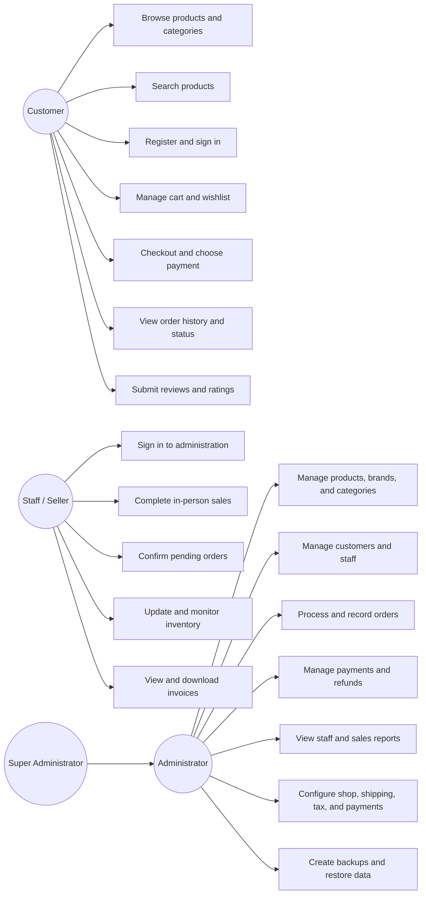

### System Architecture

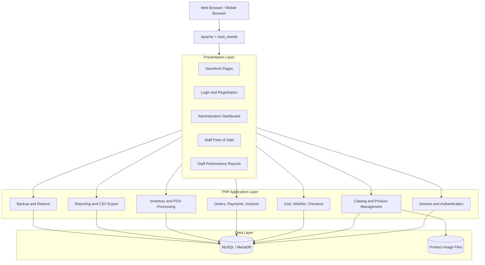

### Customer Checkout Sequence

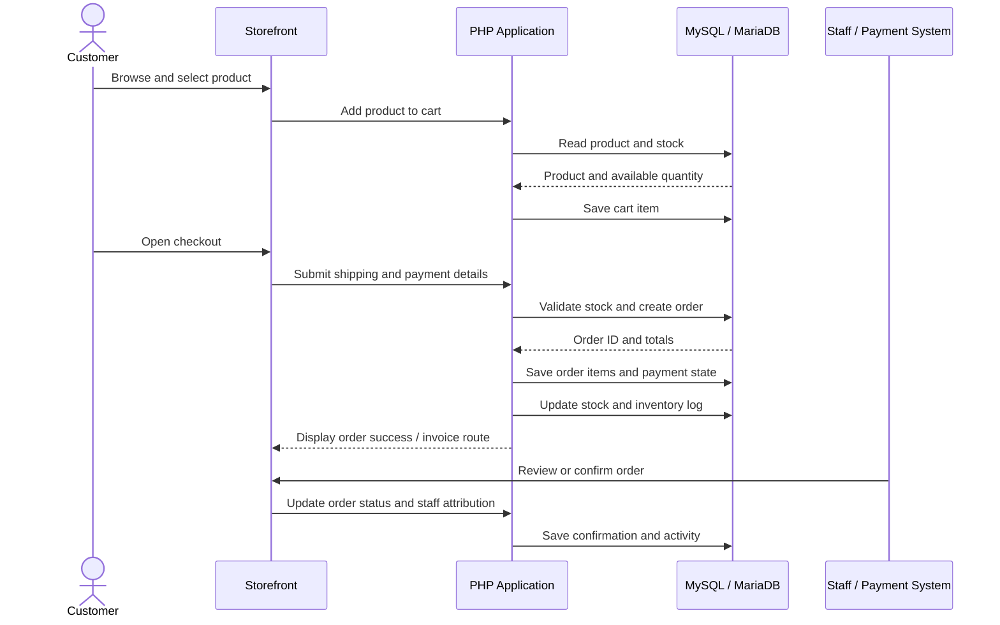

### In-Person Sale Sequence

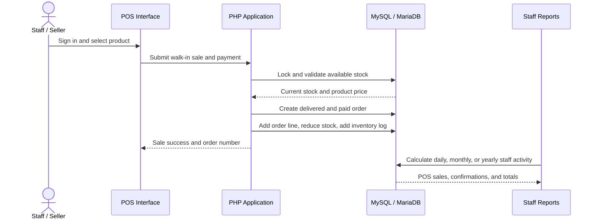

### Core Database Relationships

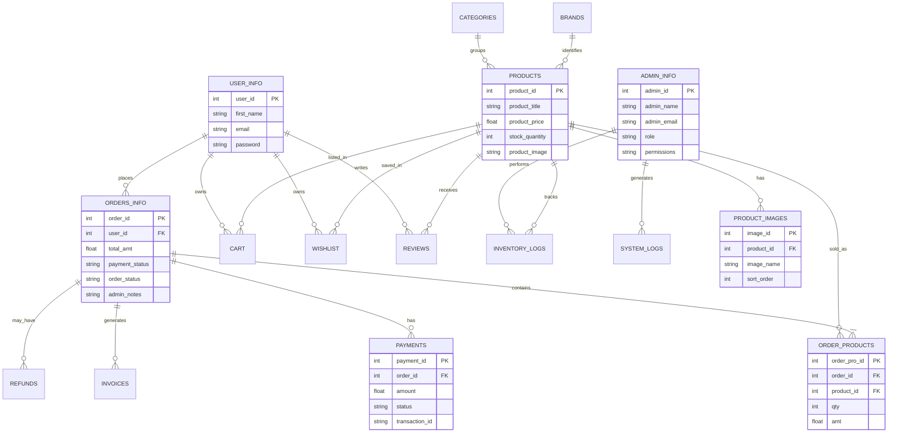

## Screenshots and System Workflow

The following local screenshots show the current system interface.

### 1. Storefront Catalog

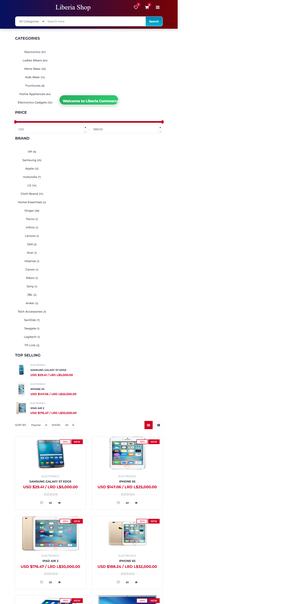

The customer begins by opening the responsive homepage or storefront, browsing categories, searching for products, viewing promotions, and opening a product.

### 2. Product Details and Gallery

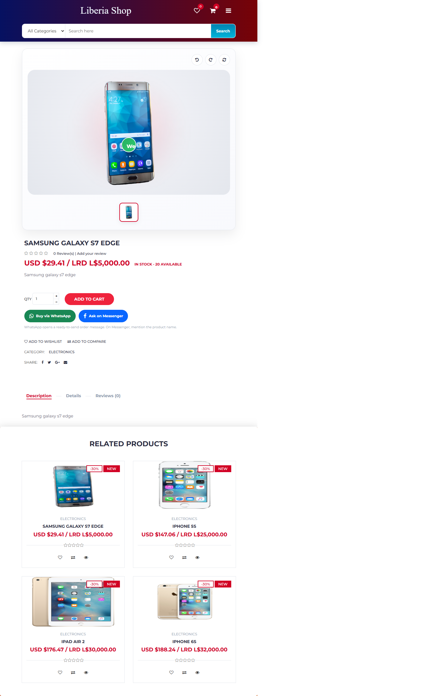

The product page displays the product price, description, stock, image gallery, quantity controls, cart actions, and related or recommended products.

### 3. Mobile Storefront


The mobile interface adapts the catalog and navigation for smaller screens and includes quick-access storefront navigation.

### 4. Login Workflow

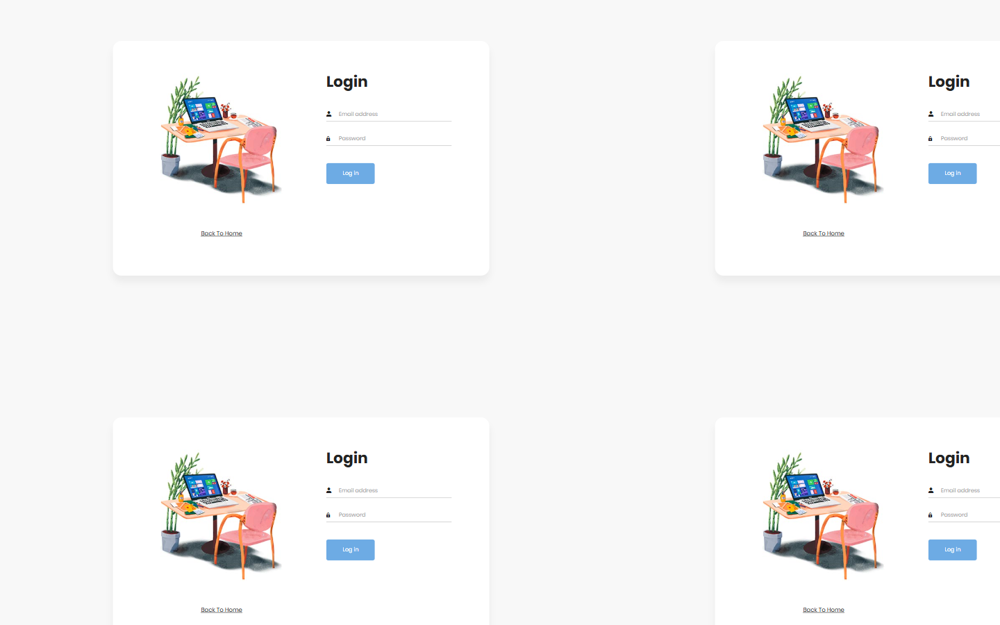

Customers use the shared login/registration workflow, while administrators and staff are authenticated through the administration system and directed by role.

### 5. Administration Dashboard

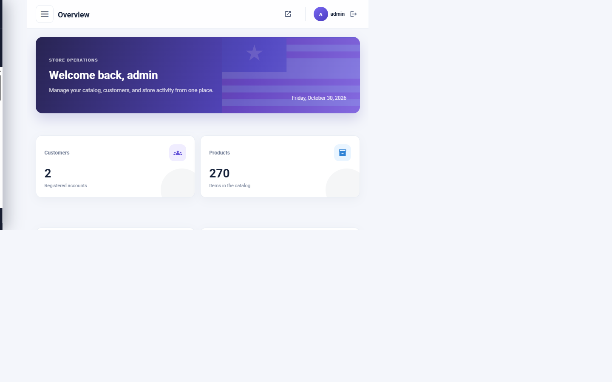

After login, the administrator sees the dashboard, navigation sidebar, operational summaries, and links to catalog, orders, payments, users, staff, settings, and backups.

### 6. In-Person Point of Sale

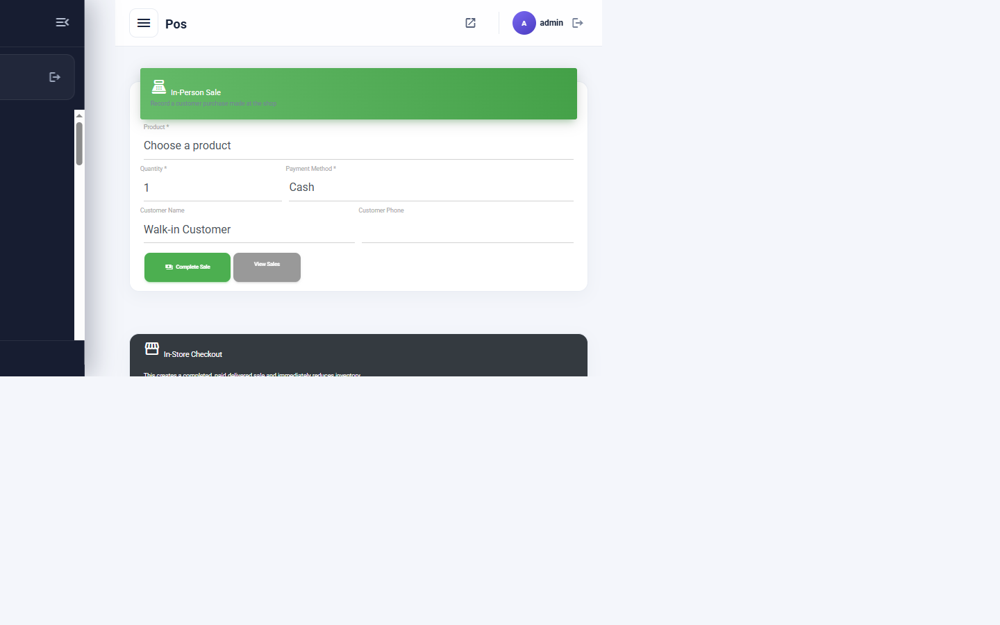

The staff seller selects a product, enters quantity and walk-in customer details, chooses a payment method, and completes the sale. The order is recorded, stock is reduced, and the staff member is attributed automatically.

### 7. Staff Performance Reporting

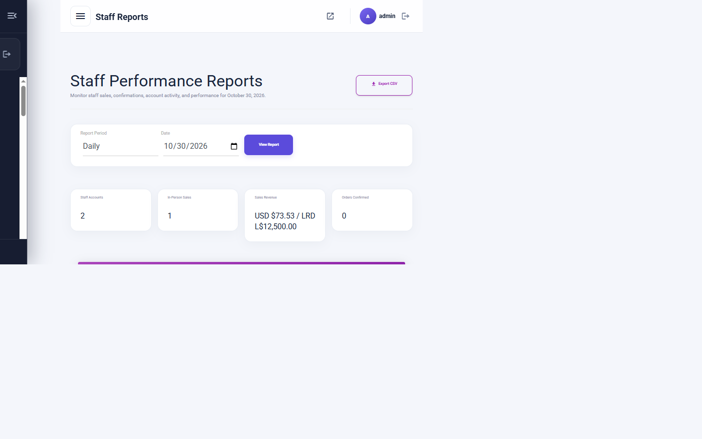

Administrators filter staff activity by day, month, or year. Sales totals, in-person order counts, confirmed-order counts, account status, and last login are displayed and can be exported as CSV.

## Running Checks

Run PHP syntax validation:

```bash
php -l db.php
php -l index.php
php -l admin/admin/index.php
```

Validate the local site:

```text
http://localhost/OnlineShop/
http://localhost/OnlineShop/store.php
http://localhost/OnlineShop/admin/login.php
```

For production, verify storefront navigation, login, registration, checkout, product gallery, POS sale, inventory reduction, invoice PDF download, payment recording, staff reports, backup access, mobile layout, and footer information links.

## Deployment Checklist

- [x] Responsive storefront and administration interface
- [x] Clean URL routing
- [x] Multi-image product galleries
- [x] Customer accounts and cart
- [x] POS in-person sales
- [x] Staff reporting and CSV export
- [x] Invoice/PDF support
- [x] Payment synchronization
- [x] Backup and restore tools
- [x] Database credentials excluded from Git
- [ ] Run a production database import after final schema review
- [ ] Confirm production database environment variables with the host
- [ ] Rotate every previously exposed credential
- [ ] Perform final live payment and login testing

## License

See the [LICENSE](LICENSE) file for licensing terms.

## Author

**Archie K Gonwoe Jr**  
Online shop developer and system administrator  
Email: archiekgonwoe@gmail.com  
GitHub: https://github.com/Archie-ctr

## Contributing

Issues and pull requests are welcome. For major architectural, database, payment, or security changes, open an issue first to discuss the proposed change.

Please use private credentials, create a database backup, and test migrations locally before submitting a production change.
